<div align="center">



<br/>

<a href="https://github.com/Jeevan073">
  
</a>

<br/>

[](https://www.linkedin.com/in/jeevanram073/)
[](https://www.instagram.com/_jack_067_/)
[](mailto:jeevan1234ram@gmail.com)


</div>


## `⬡ INPUT LAYER` — About the Builder

Hey, I'm **Jeevan Ram**, a Generative AI Engineer and AI & Data Science enthusiast.

I enjoy turning ideas into practical applications, exploring intelligent systems, and learning by building. This profile is my digital lab: a place for projects, experiments, and the tools I use to bring them to life.

```python
class Jeevan(nn.Module):
    def __init__(self):
        self.role      = "Generative AI Engineer"
        self.field     = "AI & Data Science"
        self.learns_by = ["building", "experimenting", "iterating"]
        self.optimizer = "curiosity"

    def forward(self, idea):
        prototype = self.build(idea)
        feedback  = self.test(prototype)
        return self.improve(feedback)
```

- 🧠 Exploring Generative AI and intelligent applications
- ⚡ Building projects that connect software with real-world needs
- 🧪 Learning through experiments, iteration, and open-source work


## `⬡ HIDDEN LAYER 1` — Active Builds

<div align="center">

<table>
<tr>
<td width="50%" valign="top">

### ⚡ SmartWaTT

An AI + IoT electricity usage monitoring project focused on tracking energy consumption and making usage insights more accessible.

`IoT` · `Energy Monitoring` · `AI`

</td>
<td width="50%" valign="top">

### 🎟️ Event Management System

A software project designed to help organize and manage event-related workflows.

`Application Development` · `Data Management`

</td>
</tr>
</table>

</div>

<!-- When your repos are public, link each project title: ### ⚡ [SmartWaTT](https://github.com/Jeevan073/REPO_NAME) -->


## `⬡ HIDDEN LAYER 2` — The Toolbox

**🤖 Generative AI**

<div align="center">


</div>

**🛠️ Core Stack**

<div align="center">


</div>


## `⬡ HIDDEN LAYER 3` — GitHub Telemetry

<div align="center">


<br/>


<br/>


</div>


## `⬡ OUTPUT LAYER` — Lab Notes & Contact

> **Build → Test → Learn → Improve.**

I believe every project is an experiment. Some become useful tools; others teach me what to try next. Either way, the lab keeps moving.

```text
>>> model.predict("collaboration")
[ 0.98 ]  Let's build something intelligent together.
```

<div align="center">

[](https://www.linkedin.com/in/jeevanram073/)
[](mailto:jeevan1234ram@gmail.com)

<br/>


`model.save("jeevan_ram")` &nbsp;✔ &nbsp;**Weights saved. See you in the next commit.** 🚀

<sub>Found something useful? Drop a ⭐ on a repo on your way out.</sub>

</div>
